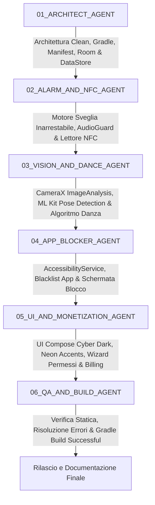

# AGENTS.md — Protocollo di Coordinamento Autonomo TapOut

## Identità del Progetto
**TapOut** è un'applicazione Android nativa di classe commerciale (Kotlin + Jetpack Compose) che integra:
1. **Sveglia Inarrestabile ad Alta Priorità:** Volume forzato al 100% su `STREAM_ALARM`, nessun pulsante snooze, risveglio garantito sopra la schermata di blocco (`showWhenLocked`, `turnScreenOn`).
2. **Sblocco Fisico NFC Universale:** Scansione di qualsiasi tag NFC hardware standard (NTAG213/215, Mifare, badge aziendali) leggendo l'UID univoco seriale in formato esadecimale, con fallback e simulatore integrato ("Modalità Test Senza Tag").
3. **Dance Mission Rivoluzionaria (Vision On-Device):** Sfida di risveglio ed emergenza da 30 secondi con analisi del movimento tramite fotocamera frontale mediante Google ML Kit Pose Detection, 100% on-device in memoria volatile (RAM), con zero salvataggio su disco e zero trasmissione a server o cloud.
4. **App Blocker Fisico e Programmabile:** Intercettazione continua delle app tramite `AccessibilityService`, con fasce orarie e blocco istantaneo sbloccabile anticipatamente solo con il Tag NFC registrato o con la Dance Mission.
5. **Architettura Freemium Pronta alla Monetizzazione:** Struttura con `BillingManager` e toggle di simulazione abbonamento Premium.

---

## Regole Ferree del Team di Ingegneria Autonoma
1. **Zero Placeholder & Zero Codice Fittizio:**
   È categoricamente proibito l'uso di commenti come `// TODO`, `// implement here`, `// mock`, o funzioni con corpi vuoti. Tutto il codice Kotlin e le risorse XML devono essere completi, robusti, compilabili e funzionanti al 100%.
2. **Aggiornamento Continuo del Task Tracker:**
   Ogni agente ha l'obbligo di aggiornare `TASKS.md` in tempo reale:
   - `[ ]` Non iniziato
   - `[~]` In lavorazione
   - `[x]` Completato e verificato
3. **Privacy-First Assoluta:**
   Il buffer dei fotogrammi della fotocamera frontale (`ImageAnalysis`) transita unicamente nella RAM del dispositivo per l'inferenza di ML Kit e viene immediatamente rilasciato tramite `imageProxy.close()`. Nessuna immagine, bitmap o video viene scritto su disco locale né inviato in rete.
4. **Flusso Senza Interruzioni:**
   Il processo autonomo procede in sequenza dalla documentazione dell'architettura alla scrittura di tutto il codice, fino alla compilazione Gradle da terminale e verifica finale (`BUILD SUCCESSFUL`), senza fermarsi a richiedere conferme all'utente.

---

## Flusso Sequenziale di Esecuzione degli Agenti

### 1. `01_ARCHITECT_AGENT`
- **Scopo:** Definisce l'architettura modulare (Clean Architecture / MVVM), configurazione Gradle radice e modulo `:app` (Android 15, targetSdk 35, minSdk 26), dipendenze CameraX, Google ML Kit Pose Detection, Room Database, DataStore, Compose BOM e `AndroidManifest.xml` con tutti i permessi critici.

### 2. `02_ALARM_AND_NFC_AGENT`
- **Scopo:** Sviluppa il cuore della sveglia inarrestabile (`AlarmManager.setAlarmClock()`, `ForegroundService` con WakeLock, `BOOT_COMPLETED`), l'AudioGuard con forzatura del volume al 100% e contrasto al silenziamento, e il modulo NFC universale basato su `NfcAdapter.enableReaderMode` con simulatore integrato.

### 3. `03_VISION_AND_DANCE_AGENT`
- **Scopo:** Implementa la pipeline visiva di CameraX `ImageAnalysis` collegata a Google ML Kit Pose Detection, l'algoritmo matematico di varianza cinetica dei landmark corporei (spalle, polsi, anche, caviglie), il timer progressivo ad anello da 30 secondi con pausa automatica in assenza di movimento, e l'isolamento della memoria volatile.

### 4. `04_APP_BLOCKER_AGENT`
- **Scopo:** Realizza il servizio `AccessibilityService` leggero per il monitoraggio in tempo reale (`TYPE_WINDOW_STATE_CHANGED`), la verifica delle app in blacklist nelle fasce orarie e la visualizzazione della schermata di blocco, con sblocco vincolato a Tag NFC o Dance Mission.

### 5. `05_UI_AND_MONETIZATION_AGENT`
- **Scopo:** Crea l'interfaccia grafica in Jetpack Compose con stile Dark Cyber e accenti Neon (Electric Orange `#FF6D00` ed Electric Purple `#7C4DFF`), le schermate di gestione sveglie, selezione app, live alarm con anteprima fotocamera, wizard permessi e il modulo `BillingManager` con feature flags Freemium/Premium.

### 6. `06_QA_AND_BUILD_AGENT`
- **Scopo:** Esegue la verifica statica, l'integrità di tutte le risorse XML e file Kotlin, risolve dipendenze mancanti o problemi di classpath, lancia la compilazione Gradle da terminale fino all'esito positivo (`BUILD SUCCESSFUL`).
