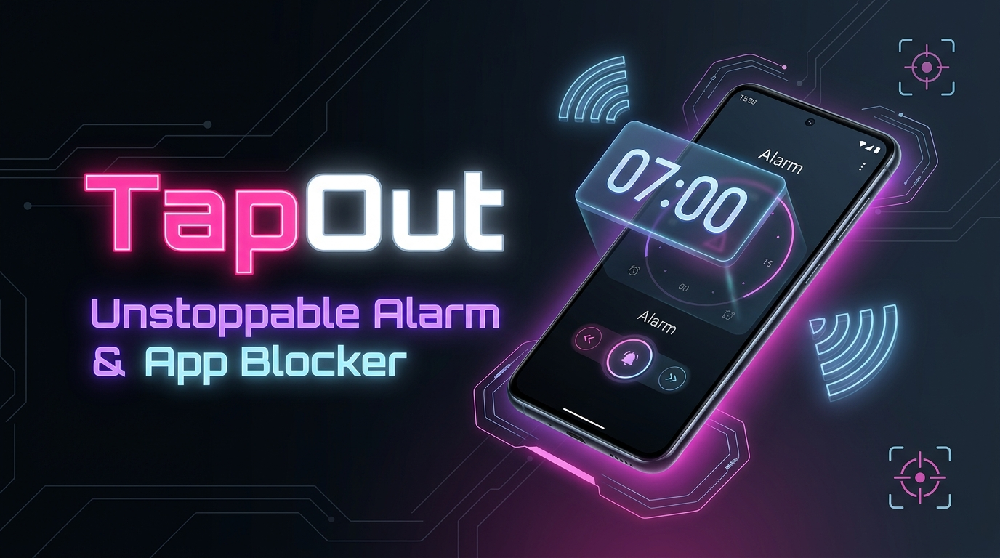
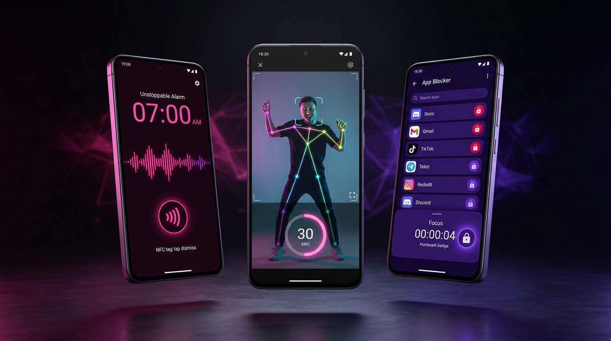

# ⚡ TapOut — Unstoppable Alarm & Physical App Blocker

<p align="center">
  
</p>

<p align="center">
  <a href="#features"></a>
  <a href="#features"></a>
  <a href="#features"></a>
  <a href="#features"></a>
  <a href="#privacy"></a>
</p>

---

## 📖 Panoramica del Progetto
**TapOut** è un'applicazione Android nativa di classe commerciale (Kotlin + Jetpack Compose) progettata per rivoluzionare il risveglio mattutino e sconfiggere la dipendenza dallo smartphone.

Combina una **sveglia inarrestabile ad altissima priorità** con un **App Blocker fisico** basato su scansione di qualsiasi **Tag NFC standard** e su **sfide visive on-device**:
1. 🕺 **Dance Mission (30s):** Riconoscimento del ballo e movimento corporeo reale tramite Google ML Kit Pose Detection.
2. 😘 **Smile & Kiss Mission (5 + 5):** Riconoscimento facciale espressivo con conteggio di 5 sorrisi e 5 baci alla fotocamera.
3. 🏷️ **Sblocco Fisico NFC Universale:** Scansione dell'UID hardware da qualsiasi tag NFC standard (NTAG213/215, Mifare, badge aziendali).
4. 🛡️ **App Blocker Fisico e Programmabile:** Blocco istantaneo (Focus Mode) o programmato su fasce orarie intelligenti (*Focus Mattutino*, *Pomeridiano*, *Notturno*), sbloccabile anticipatamente solo completando una missione fisica.

---

## 🚀 Funzionalità Chiave

<p align="center">
  
</p>

### 1. Sveglia Inarrestabile ad Alta Priorità & AudioGuard
- **Volume forzato al 100% su `STREAM_ALARM`:** Ascolto continuo in background dei tasti volume per contrastare e ripristinare all'istante qualunque tentativo di silenziamento furtivo.
- **Nessun pulsante snooze:** Risveglio garantito; l'unico modo per spegnere l'allarme è completare la sfida fisica o scansionare il tag NFC.
- **Schermata a schermo intero sopra il blocco schermo:** Integrazione con `showWhenLocked` e `turnScreenOn` con orologio digitale live sincronizzato al secondo.
- **Vibrazione intensa permanente:** Sempre attiva su tutte le sveglie configurate.
- **Resistenza ai riavvii (`BOOT_COMPLETED`):** Rischedulazione istantanea con `AlarmManager.setAlarmClock()`.

### 2. Sblocco Fisico NFC Universale
- **Hardware UID Scanner:** Lettura a basso livello con `NfcAdapter.enableReaderMode` compatibile con NTAG213, NTAG215, Mifare Ultralight, card ISO/IEC 14443-A e tessere bus/badge.
- **Pannello Rapido NFC Auto-Prompt:** Se il chip NFC del telefono è spento all'avvio della sveglia, TapOut apre automaticamente il riquadro nativo di sistema (`Settings.Panel.ACTION_NFC`) per attivarlo con **1 singolo tocco** senza abbandonare la sveglia.
- **Modalità Test Senza Tag:** Fallback integrato per collaudare l'app anche senza disporre di un tag fisico.

### 3. Dance Mission (Visione On-Device con ML Kit Pose Detection)
- Sfida cinetica da **30 secondi**: richiede all'utente di alzarsi e ballare davanti alla fotocamera frontale.
- **Algoritmo cinetico normalizzato:** Traccia la varianza dei landmark corporei (spalle, polsi, gomiti, bacino) rispetto al baricentro del torso, garantendo immunità totale allo scuotimento del dispositivo.
- **Filtro zona morta (*noise deadband*):** Il timer si arresta istantaneamente se il soggetto si ferma.

### 4. Smile & Kiss Mission (ML Kit Face Detection)
- Sfida facciale di risveglio: eseguire **5 sorrisi ampi** e **5 baci (labbra a "O")** davanti alla fotocamera.
- **Calcolo biometrico geometrico:** Analisi in tempo reale del rapporto di compressione labiale ($W_{\text{mouth}} / W_{\text{eyes}} \le 0.58$) e curvatura del sorriso.
- **Macchina a stati con isteresi anti-cheat:** Reset facciale obbligatorio tra una ripetizione e l'altra (impossibile ingannare il sistema mantenendo la stessa smorfia).

### 5. App Blocker Programmabile & Focus Immediato
- Intercettazione in tempo reale delle applicazioni tramite `AccessibilityService` leggero ed efficiente (`TYPE_WINDOW_STATE_CHANGED`).
- **Denominazione Intelligente delle Fasce:**
  - *Focus Mattutino* (05:00 - 13:00)
  - *Focus Pomeridiano* (13:00 - 21:00)
  - *Focus Notturno* (21:00 - 07:00)
- Icone autentiche estratte dinamicamente con cache LRU in memoria.
- **Sblocco d'emergenza fisico:** Possibile unicamente scansionando il tag NFC o completando la Dance Mission.

### 6. Architettura Freemium Pronta alla Monetizzazione
- **Piano Base Gratuito:** Sveglie illimitate, Dance Mission, Smile & Kiss Mission, 1 Tag NFC registrato e fino a **2 applicazioni bloccabili contemporaneamente**.
- **Piano PRO (VIP 👑):** Applicazioni bloccabili illimitate, sblocco multi-tag contemporanei, temi cyber personalizzati e streak tracking avanzato.
- **Simulatore Integrato:** Toggle rapido nelle impostazioni per testare istantaneamente il passaggio tra Base e PRO.

---

## 🔒 Privacy-First Assoluta (Zero Cloud, Zero Recording)

TapOut adotta una politica di privacy senza compromessi:
- **100% On-Device:** I fotogrammi della fotocamera frontale (`CameraX ImageAnalysis`) transitano **esclusivamente nella memoria volatile (RAM)** per il tempo strettamente necessario all'inferenza dei modelli on-device di Google ML Kit.
- **Zero Salvataggio:** Nessuna foto, fotogramma o flusso video viene mai memorizzato su disco locale o inviato in rete.
- **Rilascio Immediato:** Ogni fotogramma viene deallocato istantaneamente con `imageProxy.close()`.
- **Zero Tracker Invasivi:** L'applicazione non richiede localizzazione, contatti o permessi non strettamente necessari.

---

## 🎨 Design System: Cyber Dark & Neon Accents

L'interfaccia utente è interamente costruita con **Jetpack Compose Material 3** e segue una rigida separazione visiva:
- 🌸 **Modulo Sveglie:** *Neon Pink* (`#FF2A85` / `#FF529A`) su fondo nero profondo Cyber Black (`#08090C`).
- 💜 **Modulo Blocco App:** *Electric Purple* (`#7C4DFF` / `#9E77FF`) con card in rilievo Surface Dark (`#12141A`).
- 🟢 **Indicatori di Stato Hardware:** *Neon Mint* (`#00E676`) per chip e sensori attivi.

---

## 🛠️ Stack Tecnologico & Architettura

```
com.tapout
├── data/
│   ├── db/                 # Room Database (AppDatabase, Entità & DAO)
│   ├── model/              # Modelli dati (Alarm, BlockSchedule, BlockedApp)
│   └── repository/         # SettingsRepository (DataStore) & BillingManager
├── nfc/                    # NfcHelper (ReaderMode, hex UID formatting)
├── service/                # Foreground AlarmService & AppBlockerAccessibilityService
├── receiver/               # AlarmReceiver & BootReceiver
├── vision/                 # DanceDetector, SmileKissDetector & CameraX Analyzers
└── ui/
    ├── screens/
    │   ├── dashboard/      # Gestione sveglie (Neon Pink)
    │   ├── blocker/        # App Blocker & fasce orarie (Electric Purple)
    │   ├── dance/          # HUD cinetico Dance Mission (30s)
    │   ├── face/           # HUD facciale Sorrisi & Baci (5 + 5)
    │   ├── permissions/    # Wizard permessi accorpato & revoca singola
    │   ├── settings/       # Impostazioni, tag NFC e simulatore PRO
    │   └── alarmactive/    # Schermata sveglia a schermo intero sopra il lockscreen
    └── theme/              # Palette Cyber Dark e Tipografia
```

- **Linguaggio:** Kotlin 2.0+ con Coroutine & Flow
- **Target SDK:** Android 15 (API 35) — Min SDK 26 (Android 8.0 Oreo)
- **Framework UI:** Jetpack Compose (BOM 2024.04.01) + Material 3
- **Computer Vision:**
  - `com.google.mlkit:pose-detection:18.0.0-beta3`
  - `com.google.mlkit:face-detection:16.1.7`
  - CameraX `1.4.0` (`camera-core`, `camera-camera2`, `camera-lifecycle`, `camera-view`)
- **Persistenza:** Room Database 2.6.1 + Jetpack Preferences DataStore
- **Dependency Injection / Lifecycle:** AndroidX Lifecycle Runtime Compose & ViewModel

---

## 📱 Compilazione ed Esecuzione

### Prerequisiti
- **JDK 17** o superiore (es. JetBrains Runtime `jbr` di Android Studio).
- **Android SDK** con `platform-tools` e `platforms;android-35`.
- Dispositivo Android fisico (consigliato per NFC e CameraX) o emulatore con fotocamera abilitata.

### Comandi Gradle
```bash
# Compilazione debug dell'APK
./gradlew assembleDebug

# Installazione diretta su dispositivo connesso via ADB
adb install -r app/build/outputs/apk/debug/app-debug.apk

# Avvio dell'applicazione
adb shell am start -n com.tapout/.ui.MainActivity
```

---

## 📄 Licenza e Documentazione Aggiuntiva
- [GUIDA_UTENTE.md](GUIDA_UTENTE.md) — Manuale dettagliato d'uso, registrazione tag NFC e configurazione permessi.
- [PRIVACY_POLICY_TEMPLATE.md](PRIVACY_POLICY_TEMPLATE.md) — Informativa sulla privacy per Google Play Store (on-device vision).
- [SPECIFICATIONS.md](SPECIFICATIONS.md) — Specifiche architetturali e algoritmi matematici di visione.
- [TASKS.md](TASKS.md) — Registro completo dei 16 moduli di sviluppo e collaudo.

---

<p align="center">
  Sviluppato con passione e ingegneria autonoma per risvegli infallibili e massima produttività quotidiana. 🚀
</p>
